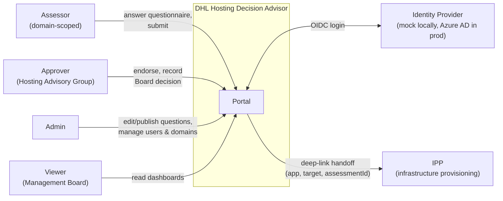
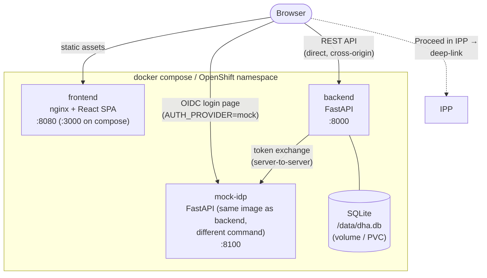
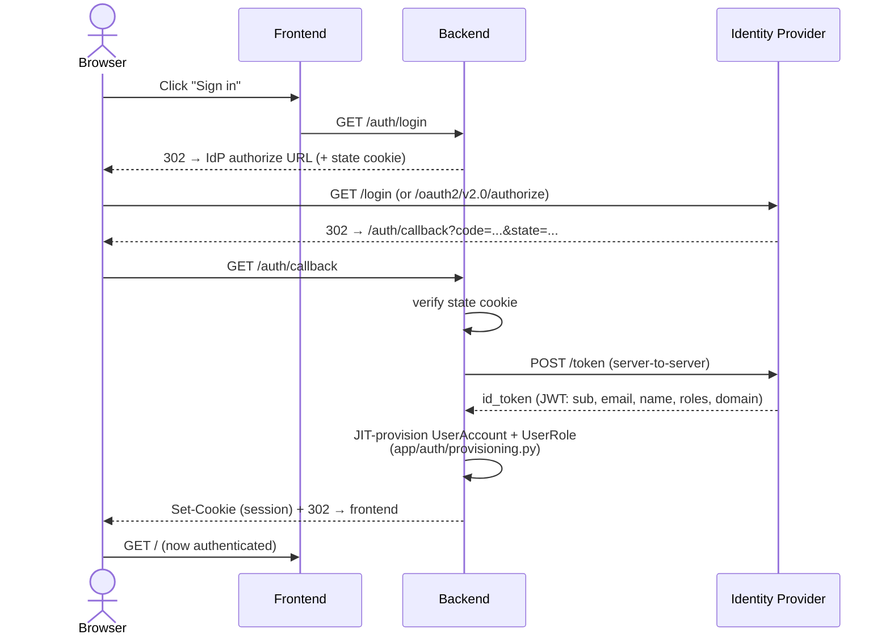
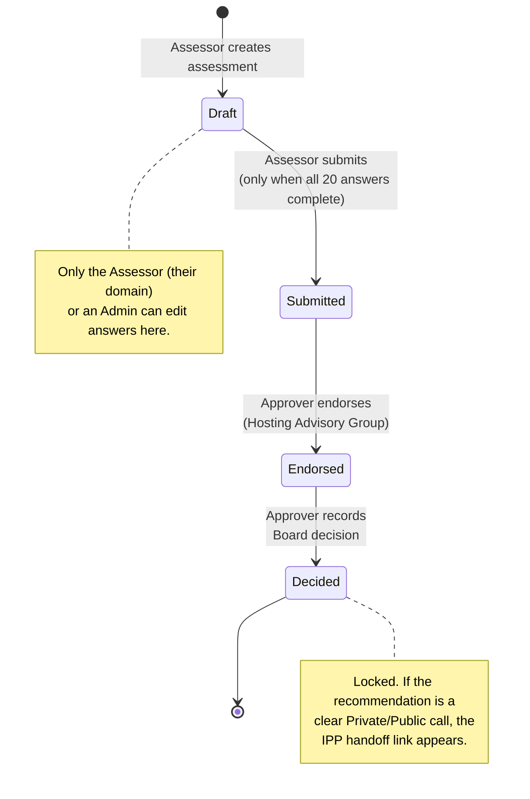
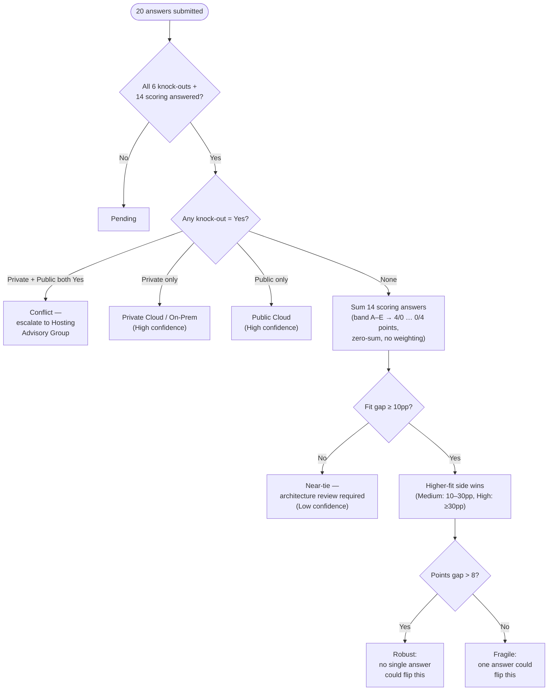
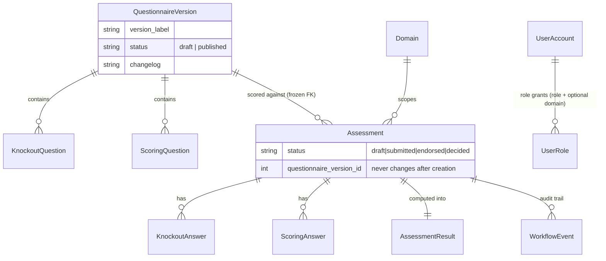

# Architecture

Diagrams render natively on GitHub (Mermaid) — no external tool needed to view or edit them.
For the narrative behind these decisions (why SQLite, why OIDC-pluggable, what must not
break), see [CLAUDE.md](CLAUDE.md).

## 1. System context

Who and what talks to this system.

## 2. Containers

Three images, no external database service — SQLite lives on a volume/PVC next to the
backend.

On OpenShift each box above is a `Deployment` + `Service` + edge-TLS `Route`
(`helm/dhl-hosting-advisor/`); on `docker compose` they're the three services in
`docker-compose.yml`. The backend is pinned to **1 replica** everywhere — SQLite is
single-writer (see CLAUDE.md § Key Invariants).

## 3. Auth flow (OIDC, provider-agnostic)

Same sequence whether `AUTH_PROVIDER` is `mock` or `azuread` — only which issuer is contacted
changes (`app/auth/oidc.py` branches once, no other code cares).

`/auth/logout` deliberately returns plain JSON, not a redirect — see the CORS note in
CLAUDE.md if you're touching that route.

## 4. Assessment workflow (state machine)

Every transition is written to `workflow_event` (actor, timestamp, notes) — the audit trail
shown on each assessment's detail page.

## 5. Decision engine

The actual rule order in `backend/app/engine/scoring.py::compute_result` — a direct port of
the source workbook's own decision rules, not something designed from scratch. See CLAUDE.md
for why each step is ordered the way it is.

Every answered question (knock-out Yes, or any scored band) is also checked for a
non-empty evidence reference — `evidence_complete=false` flags it on the result without
changing the recommendation itself.

## 6. Data model (versioning invariant)

The one relationship that makes "admin edits a question" safe: an `Assessment` points at the
exact `QuestionnaireVersion` it was scored against, forever.

Publishing a new version never touches rows on an existing `QuestionnaireVersion` — it
inserts a new one and flips which version *new* assessments start from. See CLAUDE.md §
Key Invariants before changing anything here.
